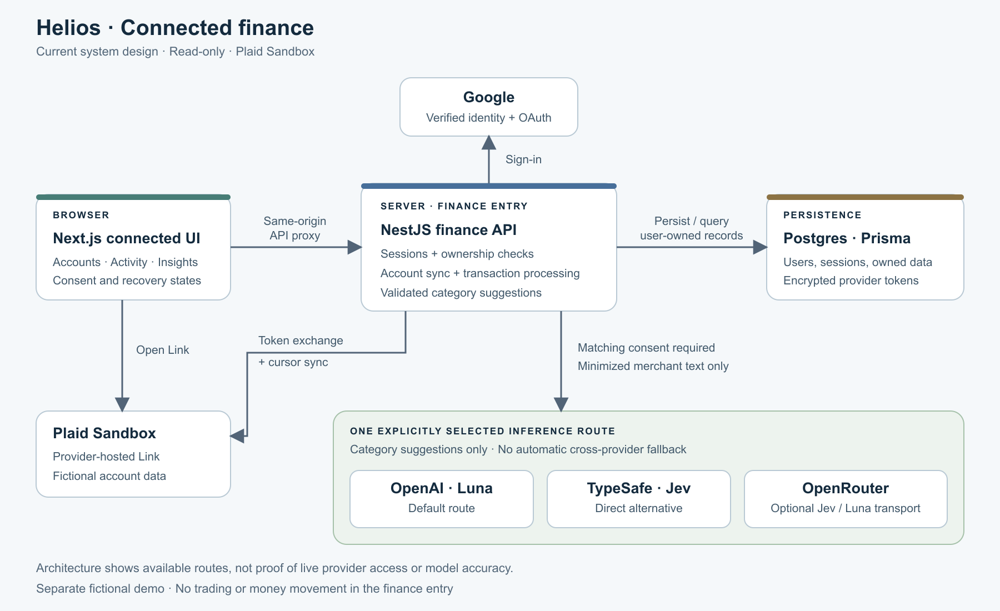

# Helios architecture and design decisions

This is the current design reference for humans and coding agents. [README.md](README.md) is the local-start entry point. [AGENTS.md](AGENTS.md) defines planning/review obligations and maps product verticals to [living architect references](.agents/architects/README.md). Historical plans under `docs/architecture` are context, not the current contract.

## Product boundary

Helios currently organizes imported account data into a read-only finance experience. The default route is connected mode; fictional UI simulations are separate. Plaid is restricted to Sandbox. There is no active money-movement or trading capability in the finance entry point. A production deployment and real-account release are future work, not consequences of configuring an API key.

Evidence: `packages/web/src/app/page.tsx:3` says `redirect("/connected");`; `packages/api/src/finance/providers.ts:64` says `if (this.environment !== 'sandbox')`. The [source map](#source-map-and-evidence) below identifies the runtime boundaries. Read the actual code before planning or reviewing a change; line numbers can move.

## Runtime and trust boundaries

Diagram source: [editable SVG](docs/diagrams/finance-architecture.svg). Update the SVG and regenerate the PNG in the same PR when these boundaries change. The diagram shows available architectural routes, not verified live provider access.

The model branches are alternatives selected explicitly on the server, not automatic fallback. Browser provider tokens are exchanged on the server; persistent Plaid access tokens are encrypted before storage. Server credentials and runtime control data do not belong in browser bundles, repository fixtures or logs. Merchant minimization reduces data exposure but does not make merchant text anonymous.

The application is a modular monolith: the web and finance API run separately, while account sync, transaction processing and classification currently share `FinanceService` and one Postgres schema. The in-process poller is not a durable external job queue. Product verticals below are ownership and reasoning boundaries; they are not claims that independent microservices already exist.

## Product verticals and contracts

| Vertical | Responsibility and output | Main collaborators |
| --- | --- | --- |
| Identity | Verified Google identity, persisted sessions and resource ownership | Every authenticated API and the sign-in UI |
| Connected accounts | Link/exchange, encrypted tokens, account facts, cursor updates and connection status | Identity, transactions, platform, experience |
| Transactions and insights | Integer amounts, accounting semantics, category provenance/corrections, imported-period summaries and observed patterns | Accounts, intelligence, experience |
| Intelligence | Explicit classifier/transport, scoped consent, minimized requests and validated purchase-category suggestions | Transactions, identity, platform, experience |
| Product experience | Connected/demo separation, readable facts, user intent, consent, status and recovery | All data-producing verticals |
| Platform | Schema/migrations, secrets/config, local services, process/log lifecycle and reproducible checks | Every vertical |

[General architecture](.agents/architects/general.md) coordinates changes crossing these boundaries. Select the relevant architects by behavior, including when a shared file touches several domains.

## Data and request flows

1. **Identity:** Google verified-email login finds or creates a User. OAuth state is checked. The callback waits for Passport session persistence before redirect; requests restore a session from Postgres and revalidate the identity.
2. **Link and sync:** an authenticated, allowed-origin request creates a Link token. The browser opens Plaid Link and returns a public token for server exchange. The API encrypts the persistent token, imports account data, buffers cursor pages, then commits transactions and cursor together. Retried sync is idempotent; tombstones and pending replacements are resolved after all pages. Connection leases limit overlapping work.
3. **Processing:** provider semantics determine accounting, then provider category/rule mappings determine presentation. User corrections are stored separately. Unchanged ambiguous purchases may retain model suggestions across sync; new provider semantics take precedence. Summaries use posted USD facts, disclose truncation/coverage and do not infer investable cash.
4. **Inference:** after matching route consent, only eligible uncertain posted purchases are considered, up to 20 per action. The selected adapter receives shortened merchant text. Output validation and abstention precede conditional persistence; no model changes amounts or income/transfer accounting. Failed access, rate limits, invalid output and unavailable providers produce visible feedback.
5. **Experience:** connected pages fetch API facts and show empty/stale/error states. Demo pages use explicitly fictional data. A loaded script, opened Link modal, successful connection and successful sync are separate outcomes to verify.

Relevant persistence models are User, FinanceSession, FinanceConnection, FinanceAccount, FinanceTransaction and FinancePreference. A connection owns accounts/transactions; preferences bind a user's inference consent to the selected route. Legacy trading models are retained but are not evidence that trading is enabled in the finance application.

## Design decisions

These decisions describe the present implementation and its accepted constraints. A change can revise a decision with explicit rationale and verification; do not silently reframe a proposal as implemented behavior.

| ID / status | Context and choice | Alternative considered | Consequences and reconsideration trigger |
| --- | --- | --- | --- |
| D01 — accepted | Isolate a NestJS finance entry while retaining the existing repository and legacy trading code. | Reuse legacy trading startup, or split into new services immediately. | Finance does not require trading-provider initialization. Revisit extraction when independent deployment, workload isolation or ownership requires it. |
| D02 — accepted | Use Postgres/Prisma for users, sessions, connection state and imported facts. Use additive migrations. | In-memory/demo persistence or adding a separate session database. | Persistent session/data behavior is testable together; schema evolution and DB availability are operational dependencies. Revisit session store/worker topology with measured scaling needs. |
| D03 — accepted | Google verified-email OAuth plus server-side sessions, ownership and mutation Origin validation. | Custom password storage or relying solely on client-side auth state. | Reuses existing identity wiring; Google access and reliable session persistence are required. Revisit for additional SSO providers, identity linking or account deletion requirements. |
| D04 — accepted, milestone limit | Plaid Sandbox only, with server exchange and encrypted access tokens. | Production/Trial account connections in the prototype milestone. | Real integration code can use fictional provider data without consuming real-account connections. Revisit only with explicit real-account release scope and institution/provider checks. |
| D05 — accepted | Commit buffered transaction pages and cursor atomically; apply tombstones after all pages; use per-connection leases and polling. | Advance cursor per page or rely on unimplemented webhooks. | Failed pagination cannot partially advance stored state. Buffer limits, lease races and in-process worker recovery remain engineering considerations. Revisit durable jobs/webhooks with operational requirements. |
| D06 — accepted | Integer minor units and deterministic accounting; categories are presentation with explicit provenance. | Model-generated arithmetic or merchant-label-driven income/transfer accounting. | Financial semantics stay auditable. USD-only summaries and imported-history limits are explicit. Revisit currency conversion and forecasting only with separate data/rounding/coverage design. |
| D07 — accepted, model quality provisional | Luna default, direct Jev option and explicit OpenRouter transports; route-bound opt-in and constrained output. | Unrestricted fallback or full-transaction generative analysis. | Different recipients require renewed consent. Jev thresholds are provisional, and transport support does not establish live availability or accuracy. Revisit after labeled quality, latency, privacy and cost evaluation. |
| D08 — accepted | Separate API-backed connected mode from the labeled fictional demo. | Silently show demo fixtures when provider/API data is missing. | Failures and empty states stay truthful; demo simulation does not imply financial execution. Revisit navigation as production journeys mature, while preserving the data boundary. |

Decision evidence is mapped below: D01/D02 to finance module/session/schema; D03 to Google/session/ownership code; D04 to provider/vault; D05 to sync; D06 to domain/snapshot; D07 to inference/consent; D08 to routes and UI. Alternatives are design analysis, not claims that an external evaluation or implementation was performed.

## Source map and evidence

Paths are repository-relative; quotes were checked when this document was introduced. Architect files provide narrower evidence and review questions.

- `packages/api/src/finance.main.ts:78`: ``return configureFinanceApp(await NestFactory.create(FinanceModule));``
- `packages/api/src/finance/finance.module.ts:14`: ``AuthModule,``
- `packages/api/src/finance.main.ts:62`: ``store: new PostgresSessionStore(app.get(FinanceDatabase)),``
- `packages/api/prisma/schema.prisma:90`: ``model FinanceConnection {``
- `packages/api/prisma/schema.prisma:152`: ``model FinancePreference {``
- `packages/api/src/auth/google.strategy.ts:52`: ``if (!emails?.[0]?.value || profile._json?.email_verified !== true) {``
- `packages/api/src/auth/auth.controller.ts:29`: ``req.logIn(req.user!, { session: true }, (error) =>``
- `packages/api/src/finance/finance.service.ts:128`: ``where: { id, userId },``
- `packages/api/src/finance/providers.ts:64`: ``if (this.environment !== 'sandbox')``
- `packages/api/src/finance/providers.ts:122`: ``const cipher = createCipheriv('aes-256-gcm', this.key(), iv);``
- `packages/api/src/finance/finance.service.ts:193`: ``await this.db.$transaction(``
- `packages/api/src/finance/domain.ts:51`: ``primary.startsWith('TRANSFER') || primary === 'LOAN_PAYMENTS';``
- `packages/api/src/finance/finance.service.ts:334`: ``if (t.currency !== 'USD' || t.pending || !t.date.startsWith(thisMonth))``
- `packages/api/src/finance/inference.ts:69`: ``get consentScope() {``
- `packages/api/src/finance/inference.ts:124`: ``allow_fallbacks: false,``
- `packages/api/src/finance/inference.ts:283`: ``if (c === 'Other' || confidence < 0.8 || probability < 0.8)``
- `packages/web/src/app/page.tsx:3`: ``redirect("/connected");``
- `packages/web/src/app/demo/page.tsx:3`: ``return <Helios />;``

## Verification and known limits

Use [local setup and checks](docs/architecture/finance-local-setup.md) for reproducible commands. Both packages have no-emit type checks; focused domain/auth tests and isolated Postgres HTTP checks cover key finance/session/provider behaviors. Stand-ins establish caller behavior, not service availability or model accuracy. Historical verification is recorded in [the milestone report](docs/architecture/verification.md); re-run relevant checks for the new diff instead of treating that report as current proof.

Known limits include Sandbox-only access, one transactions-oriented Link onboarding flow, no provider webhook subscription, no durable external worker, no generative explanations, no full cash forecast, and no production operations claim. Institution coverage/reauthorization, retention/deletion, encryption-key recovery, rate limiting, monitoring and live-model evaluation need explicit further work. Existing legacy lint/dependency debt must be reported separately. A new financial execution feature needs its own architecture and user-authorized scope; it is not an incremental toggle on this dashboard.

## Maintaining this design

Update this document in the same PR as boundary/decision changes. Each revised decision records context, choice, alternatives, consequences, status and reconsideration trigger; link a superseding decision rather than erasing its predecessor. Refresh source anchors and affected architect files when their code/contracts move. A PR should state which architects were consulted, whether decisions changed, which docs were updated or remain accurate, and which checks establish the final result.
